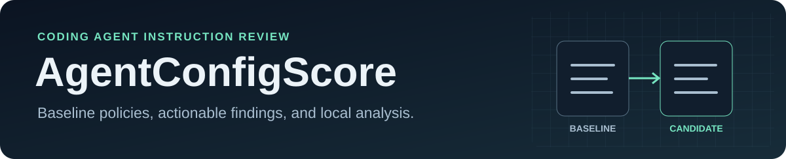
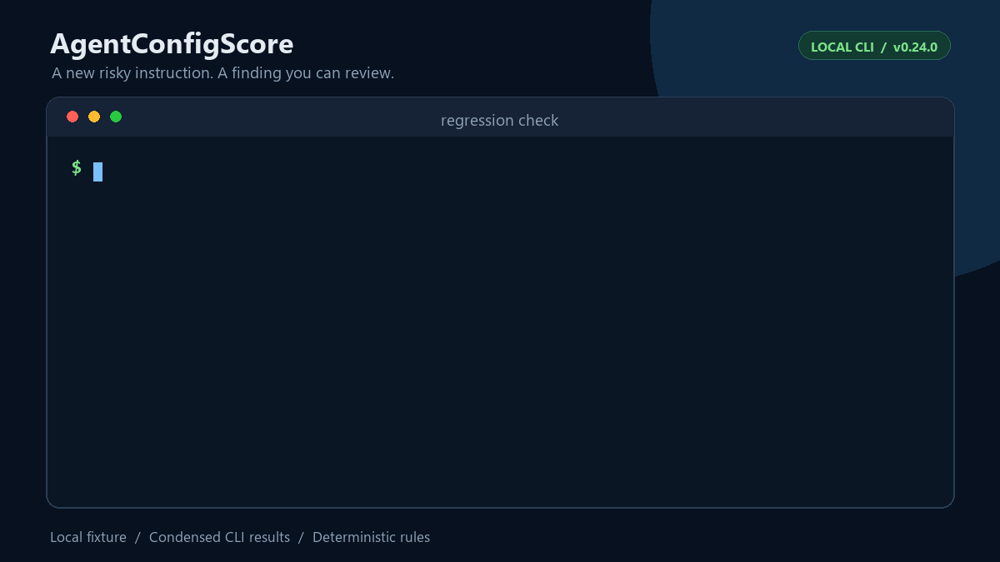
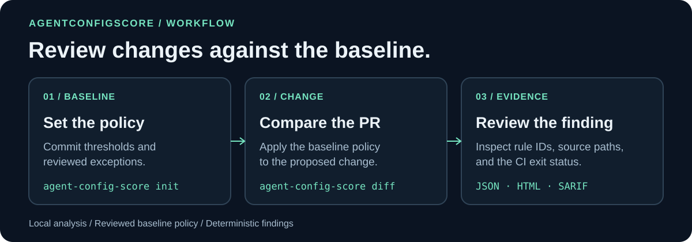
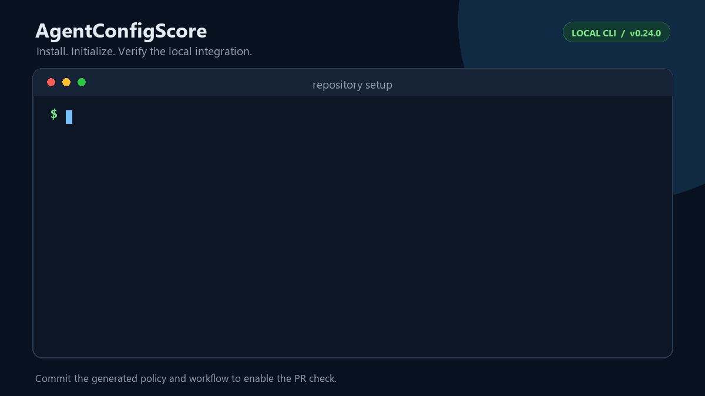
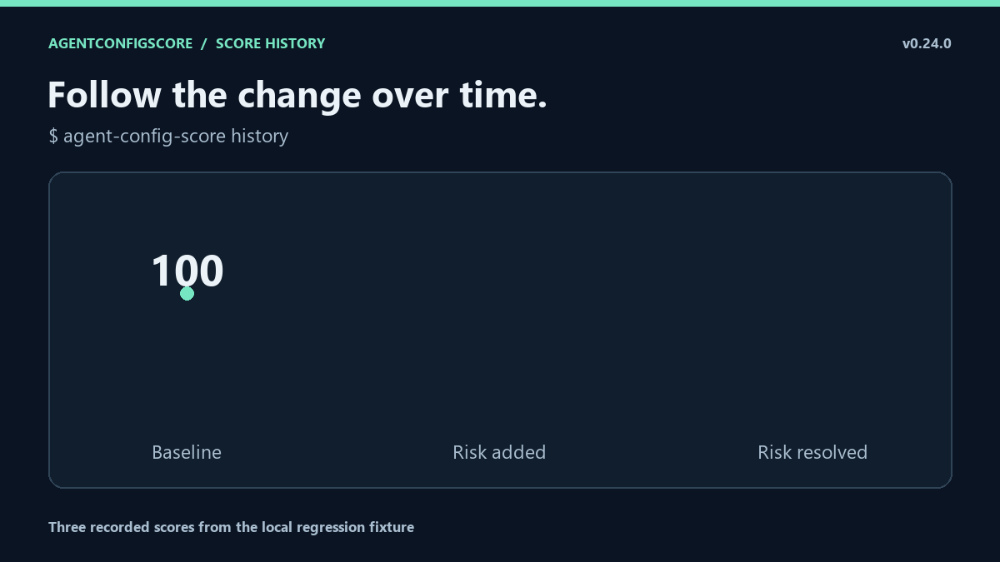

# AgentConfigScore

English | [简体中文](https://github.com/LE0-Lin/AgentConfigScore/blob/main/README.simplified.md) | [繁體中文](https://github.com/LE0-Lin/AgentConfigScore/blob/main/README.traditional.md)

<p align="center">
  
</p>

<p align="center"><strong>Catch known regressions in coding-agent instructions before merging.</strong></p>

<p align="center">
  <a href="https://github.com/LE0-Lin/AgentConfigScore/actions/workflows/ci.yml"></a>
  <a href="https://pypi.org/project/agent-config-score/"></a>
  
  
  
  
</p>

AgentConfigScore runs local, deterministic checks on `AGENTS.md`, `CLAUDE.md`,
Cursor, Copilot and Gemini instructions. It compares a change with its baseline,
reports rule-defined regressions, and uses reviewed baseline policies for CI
decisions. No model API or runtime dependencies are needed.

<p align="center">
  
</p>

[Setup demo](#quick-start) · [Workflow diagram](#what-it-helps-you-review) · [Score history demo](#score-history-demo) · [Visual gallery](https://github.com/LE0-Lin/AgentConfigScore/blob/main/docs/visual-tour.md)

The demo uses v0.24.0 on a local fixture. Adding a remote-shell instruction
lowers the score from 100 to 82, identifies `AGENTS.md:5`, and fails the
new-error gate. The gallery also includes an instruction move drawn from a
merged PR, where both scores stay 100.
[Reproduce the reduced PR case](https://github.com/LE0-Lin/AgentConfigScore/blob/main/examples/instruction-move/README.md).

**A 100 means no active deterministic rule matched.** It does not certify
instruction usefulness, semantic correctness or safety.
[Read the score contract and limitations.](https://github.com/LE0-Lin/AgentConfigScore/blob/main/docs/limitations.md)

## What it helps you review

| Change | Review evidence |
|---|---|
| Add a recognized unsafe command, exposed credential or broken path | Rule ID, explanation and source location where available |
| Delete an instruction file or reverse an exact directive | A regression-only finding, even when both numeric scores stay the same |
| Lower the candidate's threshold or add its own exception | The normal comparison still uses baseline policy and suppressions; trusted caller overrides are explicit |
| Accept a known exception | A reason, expiry and visible audit record |

Existing repositories can adopt the gate without first reaching 100.
`init` enables new-error blocking and no score decrease; a passing comparison
means no regression under the selected rules and policy.



## Quick start

Run inside your repository with a supported instruction file:

```bash
python -m pip install --upgrade agent-config-score
agent-config-score --version
agent-config-score init
agent-config-score doctor
agent-config-score diff
```

Review and commit the generated `.agentconfigscore.json` and
`.github/workflows/agent-config-score.yml`. `init` does not write your agent
instructions or overwrite conflicting setup files by default. `acs` and
`python -m agent_config_score` are alternative entrypoints.

`diff` includes uncommitted changes. It detects a conservative local baseline
without fetching; use `agent-config-score diff origin/main` when you want an
explicit ref. The [user guide](https://github.com/LE0-Lin/AgentConfigScore/blob/main/docs/user-guide.md)
covers setup, exits and troubleshooting.



*The v0.24.0 demo shows setup and selected checks from `doctor` in a local fixture.*

## Release status

v0.26.1 Beta includes local lint, baseline-governed regression checks, auditable
exceptions, reports, safeguard review and opt-in Cursor attachment/coverage
analysis. The Cursor profile is a bounded static prediction with explicit
unknowns. See the [release and upgrade notes](https://github.com/LE0-Lin/AgentConfigScore/blob/main/docs/releases/v0.26.1.md).

## Cursor attachment changes

An instruction can stop attaching even when its words and score stay unchanged.
For a declared API-only task:

| Property | Baseline | Candidate |
|---|---|---|
| Instruction | Never delete files without approval. | Same text |
| Cursor glob | `src/**` | `src/web/**` |
| Declared task file | `src/api/service.py` | Same path |
| Ordinary scan score | 100 | 100 |
| Predicted automatic attachment | Active | Inactive |

From a repository checkout, install the package and run the synthetic example:

```bash
python -m pip install --upgrade "agent-config-score==0.26.1"
agent-config-score scope compare \
  examples/cursor-scope-impact/base examples/cursor-scope-impact/narrowed \
  --target src/api/service.py --fail-on-lost-directives --fail-on-unknown
```

Expected exit **1**: review is requested for the lost recognized active directive.
Reports identify metadata and directive source lines. Another active copy or a
remaining multi-file trigger can retain availability; manual/model-selected
loading and unsupported inputs remain unknown.

The comparison models the **same declared file context** on both sides. It does
not observe an agent run or prove semantic equivalence. Comparisons are advisory
unless flags opt into the review gate; these flags are caller-owned and do not
extend the existing baseline score-policy schema.

Try the [four controls](https://github.com/LE0-Lin/AgentConfigScore/blob/main/examples/cursor-scope-impact/README.md),
or use [`scope diff` with a local Git baseline](https://github.com/LE0-Lin/AgentConfigScore/blob/main/docs/cursor-scope-impact.md).

To find affected files without declaring a task, v0.25.0+ also provides
`scope coverage --base-ref origin/main --under src`. It inventories regular
files on both sides and checks each as a separate context, keeping an API-only
loss visible when a frontend file still matches. The
[coverage guide and installed replay](https://github.com/LE0-Lin/AgentConfigScore/blob/main/docs/cursor-coverage.md)
include a repair, rename, uncertainty and unchanged controls.

### Add coverage to CI (v0.26.0+)

```bash
agent-config-score init --coverage-under src --dry-run
agent-config-score init --coverage-under src
```

Review and commit the generated files. The opt-in read-only workflow combines
the normal gate with strict per-file coverage, a readable job summary and
seven-day report artifacts. Existing setups can use `--workflow-only` and an
explicit reviewed `--force`. See the [complete adoption path](https://github.com/LE0-Lin/AgentConfigScore/blob/main/docs/cursor-coverage.md#ci-setup-and-review-artifacts)
and [design and shipped boundary](https://github.com/LE0-Lin/AgentConfigScore/blob/main/docs/architecture.md).

## Repository policy + editor validation

The generated policy enables regression checks:

```json
{
  "$schema": "https://raw.githubusercontent.com/LE0-Lin/AgentConfigScore/v0/schema/agentconfigscore.schema.json",
  "version": 1,
  "policy": {
    "max_drop": 0,
    "fail_on_new_errors": true
  }
}
```

Normal `diff` / `compare` and the reusable Action use the baseline's policy,
so candidate threshold edits cannot approve that same change. The candidate
config is still validated. Explicit CLI/Action overrides belong to the trusted
caller. [Policy defaults, schema and overrides](https://github.com/LE0-Lin/AgentConfigScore/blob/main/docs/reference.md#repository-policy--editor-validation).

## Auditable exceptions

An accepted exception requires a stable rule ID, reason and expiry. Suppressed
findings remain visible. Normal regression comparisons apply the baseline
suppression set to both sides; a PR cannot authorize its own new exception.
[Suppression format and audit behavior](https://github.com/LE0-Lin/AgentConfigScore/blob/main/docs/reference.md#auditable-exceptions).

## What it scans

Discovery includes root/nested `AGENTS.md` and `AGENTS.override.md`,
`CLAUDE.md`, `GEMINI.md`, legacy `.cursorrules`, `.cursor/rules/*.md` / `*.mdc`,
`.github/copilot-instructions.md`, `.github/instructions/*.md`, `.claude/**/*.md`,
`.clinerules` and `.windsurfrules`. `.agentconfigscoreignore` excludes discovery paths.

Format discovery does not imply complete language or native loading semantics.
The dedicated Cursor profile models root `.cursor/rules/` separately and treats
plain `.md` as ignored there. See [scope/override handling](https://github.com/LE0-Lin/AgentConfigScore/blob/main/docs/reference.md#nested-agentsmd-scopes-and-overrides)
and [copy-ready templates](https://github.com/LE0-Lin/AgentConfigScore/blob/main/examples/README.md).

## Evidence and limits

- Maintained synthetic contracts and negative controls check defined behavior.
  Known semantic misses remain visible; these are not real-world accuracy estimates.
- The current [pinned-repository smoke corpus](https://github.com/LE0-Lin/AgentConfigScore/blob/main/benchmarks/README.md)
  has **five completed scans and one expected source rejection**. Pinned Reaparr
  is rejected for a dangling instruction link and receives **no score**.
  Its historical A 100 predates strict source validation and is not the current result.
- An independent comparison with direct AI review has not been completed.
  See the [comparison protocol](https://github.com/LE0-Lin/AgentConfigScore/blob/main/docs/review-comparison.md).
  Scanning public repositories does not establish adoption.

A high score can miss vague guidance, paraphrased contradictions or harmful text
outside the rule grammar. Local analysis does not call a model API or execute
instruction-file commands. Reports can contain repository details; review them
before sharing. [Limits](https://github.com/LE0-Lin/AgentConfigScore/blob/main/docs/limitations.md)
and [privacy-minimized feedback drafts](https://github.com/LE0-Lin/AgentConfigScore/blob/main/docs/user-guide.md#6-save-reports-locally).

## Documentation

| Task | Reference |
|---|---|
| Install, initialize, understand exits | [User guide](https://github.com/LE0-Lin/AgentConfigScore/blob/main/docs/user-guide.md) |
| Configure policy, CLI, Action inputs/outputs or SARIF | [Detailed reference](https://github.com/LE0-Lin/AgentConfigScore/blob/main/docs/reference.md) |
| Explain findings or set up optional PR comments | [Maintainer workflow](https://github.com/LE0-Lin/AgentConfigScore/blob/main/docs/maintainer-workflow.md) |
| Review missing deletion safeguards | [Opt-in guardrail suggestions](https://github.com/LE0-Lin/AgentConfigScore/blob/main/docs/guardrail-suggestions.md) |
| Inspect installed rules | `agent-config-score rules` |
| Keep score history | [History workflow](https://github.com/LE0-Lin/AgentConfigScore/blob/main/docs/score-history.md) |
| Browse all topics | [Documentation index](https://github.com/LE0-Lin/AgentConfigScore/blob/main/docs/README.md) |

## Score history demo



The chart shows three locally recorded fixture scores read by
`agent-config-score history`. [Set up the history workflow.](https://github.com/LE0-Lin/AgentConfigScore/blob/main/docs/score-history.md)

The [visual tour](https://github.com/LE0-Lin/AgentConfigScore/blob/main/docs/visual-tour.md)
explains each demo. Choose [简体中文](https://github.com/LE0-Lin/AgentConfigScore/blob/main/README.simplified.md)
or [繁體中文](https://github.com/LE0-Lin/AgentConfigScore/blob/main/README.traditional.md)
for the localized overview, guide and limitations; advanced references remain English.

## Development

```bash
python -m pip install -e .
python -m unittest discover -s tests -v
agent-config-score . --fail-under 90
```

[Contributions](https://github.com/LE0-Lin/AgentConfigScore/blob/main/CONTRIBUTING.md)
and reproducible false-positive/regression cases are welcome.
[MIT licensed.](https://github.com/LE0-Lin/AgentConfigScore/blob/main/LICENSE)
