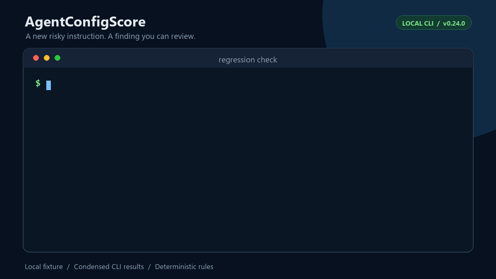
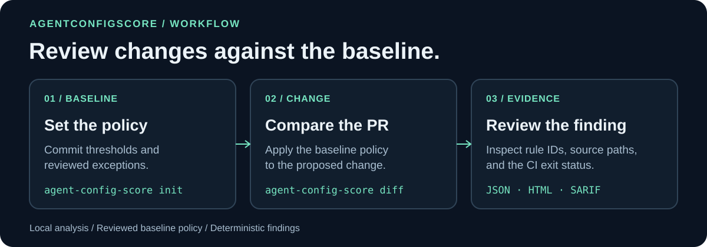
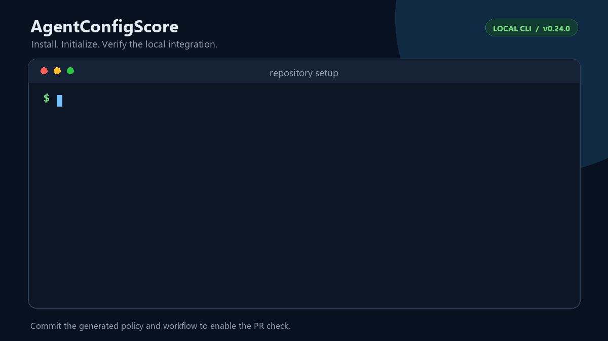
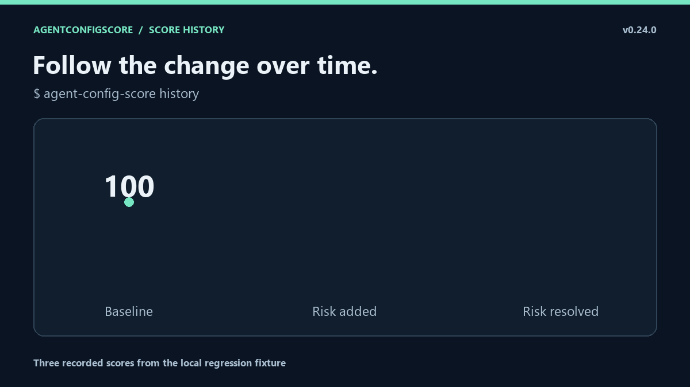

# AgentConfigScore

[English](README.md) | 简体中文 | [繁體中文](README.traditional.md)

在合并前发现 AI 编程助手指令中的已知退化。



[安装演示](#快速开始) · [分数历史演示](#分数历史演示) · [完整演示图集](docs/visual-tour.md)

演示使用 v0.24.0 扫描本地样例。新增远程脚本指令后，分数从 100 降到 82，工具定位到 `AGENTS.md:5`，新增错误门禁返回 1。图集还保留了取材自已合并 PR 的文件迁移演示，展示前后同为 100 分时的路径复核。[复跑精简 PR 案例](examples/instruction-move/README.md)。

AgentConfigScore 检查 `AGENTS.md`、`CLAUDE.md`、Cursor、Copilot、Gemini 等配置，并比较改动前后的基线，回答一个具体问题：**这次改动是否引入了已知规则能检测到的风险？**

| 改动 | 审查依据 |
|---|---|
| 加入已知危险命令、凭据或失效路径 | 规则 ID、说明及可用的来源位置 |
| 删除指令文件或反转精确指令 | 独立于总分的回归发现，即使分数相同也能报告 |
| PR 放宽自己的阈值或增加豁免 | 正常比较仍使用基线策略；调用方的显式覆盖需单独审核 |
| 接受已知例外 | 必须填写原因和到期日期，并保留审计记录 |



它是确定性检查器，不是 AI 评委。**A 100 只表示没有命中生效的规则，不表示指令有用、语义完美或安全无误。** 中文文档也不意味着检测器已经能够理解任意中文指令。

## 快速开始

需要 Python 3.10+。`diff` 还需要 Git；普通目录扫描和两个目录之间的 `compare` 不需要 Git。

```bash
python -m pip install --upgrade agent-config-score
agent-config-score --version
agent-config-score init
agent-config-score doctor
agent-config-score diff
```

在自己的仓库目录中运行。`init` 会生成 `.agentconfigscore.json` 和 `.github/workflows/agent-config-score.yml`；检查后提交这两个文件，后续 PR 即可自动检查。它不会替你编写或重写指令文件，也不会默认覆盖冲突的已有配置。

`acs` 是短命令别名。v0.23.0+ 还可以使用 `python -m agent_config_score`，避免终端 PATH 没有找到命令的问题。



*动图使用 v0.24.0 展示本地样例的接入步骤和部分 `doctor` 检查结果。*

- [简体中文使用指南](docs/simplified/user-guide.md)：安装、基线、报告、退出码与排错。
- [分数含义与限制](docs/simplified/limitations.md)：先了解什么能检出、什么仍可能漏掉。
- [完整英文文档索引](docs/README.md)：进阶接口与研究资料。
- [详细参考（英文）](docs/reference.md)：策略、CLI、Action 参数、SARIF 和审计格式。

## 发布版与源码版

| 版本 | 可用能力 |
|---|---|
| 已发布 v0.24.0 | 本地检查、基线回归门禁、可审计豁免、报告及可选删除保护审核 |
| `main` 上尚未发布的源码 | Cursor 文件上下文加载预测、修改前后加载变化审核，以及变更日志中的修复 |

PyPI 包和滚动 `v0` Action **不包含尚未发布的 Cursor 命令**。安装和选择 Action 引用前，请查看[发布说明（英文）](docs/releases/v0.24.0.md)和[变更日志（英文）](CHANGELOG.md)。

## Cursor 加载变化审核——尚未发布的源码功能

对于只声明后端文件 `src/api/service.py` 的任务，保持 `Never delete files without approval.` 正文不变，仅把 Cursor glob 从 `src/**` 改为 `src/web/**`，两侧普通评分仍是 **100**，预计自动加载却从活动变为不活动。

在源码仓库目录中运行合成示例：

```bash
python -m pip install -e .
agent-config-score scope compare \
  examples/cursor-scope-impact/base examples/cursor-scope-impact/narrowed \
  --target src/api/service.py --fail-on-lost-directives --fail-on-unknown
```

预期退出码为 **1**：已识别的活动指令失去自动加载来源，需要审核。报告给出元数据与指令行号；另一条活动规则中的相同指令，或任务中其他仍匹配的文件，可以保留可用性。手动／模型选择加载及不支持的输入保留为未知。

比较两侧使用同一组声明的文件上下文，不观察实际 Agent 行为，也不证明语义等价。默认比较只给建议；两个标志显式启用调用方的审核门禁，不扩展现有基线评分策略格式。详见[四个对照（英文）](examples/cursor-scope-impact/README.md)和[Git 基线比较与 CI 示例（英文）](docs/cursor-scope-impact.md)。

## 为什么采用回归检查

现有仓库不必先达到 100 分才能接入。如果基线是 72 分，没有退步的改动可以通过；降低分数或引入新错误的改动则依据配置被拦截。

初始化后的核心策略如下：

```json
{
  "$schema": "https://raw.githubusercontent.com/LE0-Lin/AgentConfigScore/v0/schema/agentconfigscore.schema.json",
  "version": 1,
  "policy": {
    "max_drop": 0,
    "fail_on_new_errors": true
  }
}
```

比较时以**基线策略**为准：PR 不能通过放宽自己的阈值，或新增自己的豁免来批准自己。需要接受某项例外时，必须经过基线审核，填写规则 ID、原因和到期日期；被豁免的发现仍保留审计记录。

普通扫描默认只报告发现，不因发现问题就自动失败。需要绝对分数门槛时显式设置：

```bash
agent-config-score . --fail-under 90
```

## 本地检查与报告

```bash
agent-config-score .
agent-config-score rules curl-pipe-shell
agent-config-score diff origin/main
agent-config-score compare ../repo-base . --max-drop 0 --fail-on-new-errors
agent-config-score . --json
agent-config-score . --html .agent-config-score/report.html --sarif .agent-config-score/results.sarif
```

`diff` 包含未提交的工作区改动，自动基线检测不联网、不自动 fetch。找不到基线时，明确指定本地已有的默认分支引用。

规则、行号和上下文比数字本身更重要。报告可能包含仓库路径和发现信息，公开分享前请检查。`feedback` 可生成隐私最小化的本地草稿，但不会上传，仍需自己审核。

## 接入 GitHub Actions

优先使用 `init` 生成工作流，也可以手工配置：

```yaml
name: agent-config-regression

on:
  pull_request:

permissions:
  contents: read

jobs:
  regression:
    runs-on: ubuntu-latest
    steps:
      - uses: actions/checkout@v7
        with:
          fetch-depth: 0
      - uses: LE0-Lin/AgentConfigScore@v0.24.0
```

固定 `@v0.24.0` 有利于复现；`@v0` 是会随后续版本更新的滚动引用。PR 评论属于[可选集成（英文）](docs/pr-comments.md)，扫描器默认不替你发评论。

## 支持的指令文件

包括根目录和嵌套目录的 `AGENTS.md` / `AGENTS.override.md`、`CLAUDE.md`、`GEMINI.md`、Cursor 的 `.cursorrules` / `.cursor/rules/`、Copilot 的 `.github/copilot-instructions.md` / `.github/instructions/`，以及 `.claude/`、`.clinerules`、`.windsurfrules`。可使用 `.agentconfigscoreignore` 排除发现路径。

准备自己的指令文件时，可参考[复制即用模板（英文）](examples/README.md)，并替换成仓库真正的命令和约束。不要为了得高分而复制空泛的“最佳实践”。

## 可靠性与边界

运行时没有第三方依赖；本地扫描不调用 AI API，也不执行指令文件中的命令。包安装需要访问所选软件包索引；GitHub Actions 是单独的 CI 环境，报告访问权限由你的工作流控制。

跨平台测试、维护的合成用例和安装验收验证指定的工程行为；已知语义漏报仍保留。当前固定版本的真实仓库回放中，5 个完成扫描，1 个按预期拒绝来源：Reaparr 的失效指令链接导致拒绝扫描，**没有分数**；历史 A 100 早于严格来源验证，不是当前结果。

独立 AI 对照评测尚未完成。这些开发与兼容性结果不是现实准确率、AI 优势或用户采用证据。详见[限制说明](docs/simplified/limitations.md)与[当前评测记录（英文）](benchmarks/README.md)。

本页与英文首页对齐核心功能；使用指南和限制说明也提供中文。详细参考、规则语法、贡献及研究文档目前仍为英文。[翻译范围与维护说明](docs/translations.md)。命令、终端消息和 JSON 协议保持原样，English 仍是默认入口。

## 分数历史演示



图中的三次评分由 `agent-config-score history` 读取。[历史工作流（英文）](docs/score-history.md)

项目采用 [MIT 协议](LICENSE)。[发布与升级说明](docs/releases/v0.24.0.md)目前为英文。
