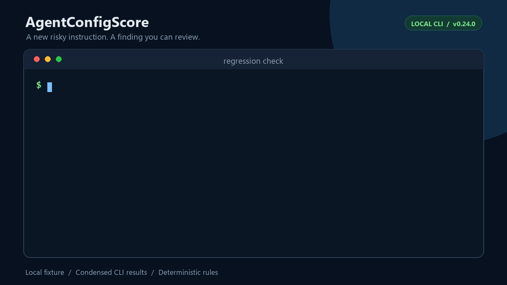
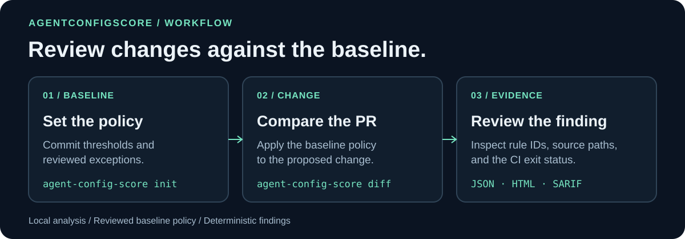
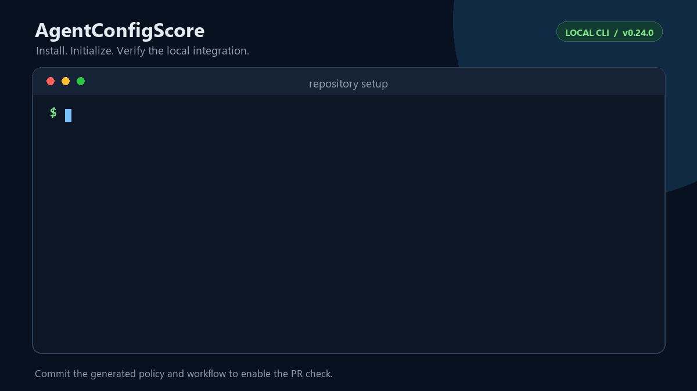
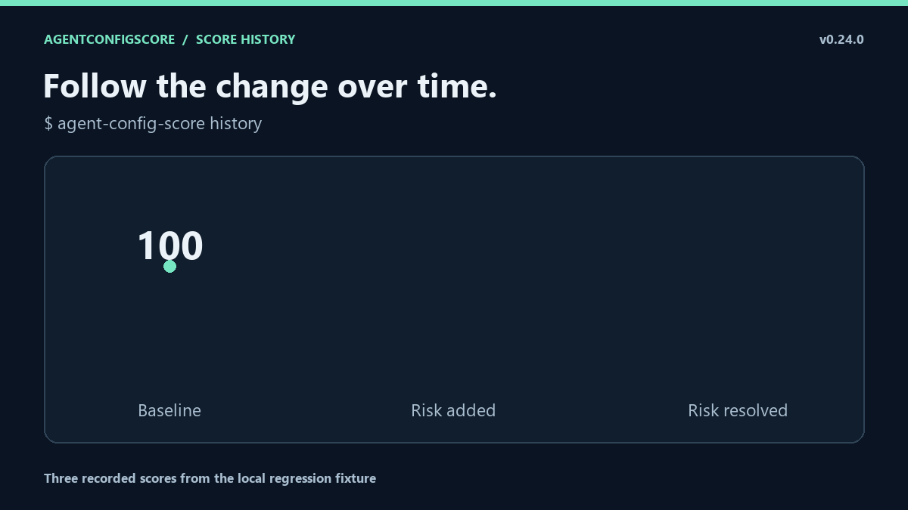

# AgentConfigScore

[English](README.md) | [简体中文](README.simplified.md) | 繁體中文

在合併前發現 AI 程式開發助手指令中的已知退化。



[安裝示範](#快速開始) · [分數歷史示範](#分數歷史示範) · [完整示範圖集](docs/visual-tour.md)

示範取材自一條已合併的 PR。指令檔原樣移至儲存庫根目錄，前後都得 100 分，比較結果仍指出需要審閱的舊路徑。[重現精簡範例](examples/instruction-move/README.md)。

AgentConfigScore 檢查 `AGENTS.md`、`CLAUDE.md`、Cursor、Copilot、Gemini 等設定，並與改動前的基準比較，回答一個具體問題：**這次改動是否引入了已知規則能偵測到的風險？**

| 改動 | 審閱依據 |
|---|---|
| 加入已知危險命令、憑證或失效路徑 | 規則 ID、說明及可用的來源位置 |
| 刪除指令檔或反轉精確指令 | 獨立於總分的回歸發現，即使分數相同也能回報 |
| PR 放寬自己的門檻或增加排除設定 | 一般比較仍使用基準策略；呼叫端的明確覆寫須另行審閱 |
| 接受已知例外 | 必須填寫原因和到期日期，並保留稽核紀錄 |



它是確定性的檢查工具，不是 AI 評審。**A 100 只表示沒有命中生效的規則，不代表指令實用、語意完美或完全安全。** 提供中文文件也不表示檢查工具已經能理解任意中文指令。

## 快速開始

需要 Python 3.10+。`diff` 另外需要 Git；一般目錄掃描和兩個目錄之間的 `compare` 不需要 Git。

```bash
python -m pip install --upgrade agent-config-score
agent-config-score --version
agent-config-score init
agent-config-score doctor
agent-config-score diff
```

請在自己的儲存庫目錄執行。`init` 會建立 `.agentconfigscore.json` 和 `.github/workflows/agent-config-score.yml`；檢查並提交這兩個檔案後，後續 PR 即可自動檢查。它不會替你撰寫或改寫指令檔，也不會預設覆寫已存在且內容衝突的設定。

`acs` 是較短的命令別名。v0.23.0+ 也能使用 `python -m agent_config_score`，不必依賴終端機 PATH 找到主命令。



*動畫使用 v0.24.0 展示本機範例的整合步驟及部分 `doctor` 檢查結果。*

- [繁體中文使用指南](docs/traditional/user-guide.md)：安裝、基準、報告、結束代碼與疑難排解。
- [分數意義與限制](docs/traditional/limitations.md)：先了解能偵測哪些問題，以及可能遺漏什麼。
- [完整英文文件索引](docs/README.md)：進階介面與研究資料。
- [詳細參考（英文）](docs/reference.md)：策略、CLI、Action 參數、SARIF 和稽核格式。

## 發布版與原始碼版

| 版本 | 可用能力 |
|---|---|
| 已發布 v0.24.0 | 本機檢查、基準回歸檢查、可稽核的例外、報告及選用刪除保護審閱 |
| `main` 上尚未發布的原始碼 | Cursor 檔案上下文載入預測、修改前後載入變化審閱，以及變更紀錄中的修正 |

PyPI 套件和滾動 `v0` Action **不包含尚未發布的 Cursor 命令**。安裝及選擇 Action 參照前，請查看[發布說明（英文）](docs/releases/v0.24.0.md)和[變更紀錄（英文）](CHANGELOG.md)。

## Cursor 載入變化審閱——尚未發布的原始碼功能

對於只宣告後端檔案 `src/api/service.py` 的任務，保持 `Never delete files without approval.` 正文不變，僅把 Cursor glob 從 `src/**` 改為 `src/web/**`，兩側一般評分仍是 **100**，預測自動載入卻從活動變為不活動。

在原始碼儲存庫目錄中執行合成範例：

```bash
python -m pip install -e .
agent-config-score scope compare \
  examples/cursor-scope-impact/base examples/cursor-scope-impact/narrowed \
  --target src/api/service.py --fail-on-lost-directives --fail-on-unknown
```

預期結束代碼為 **1**：已識別的活動指令失去自動載入來源，需要審閱。報告給出中繼資料與指令行號；另一條活動規則中的相同指令，或任務中其他仍符合的檔案，可以保留可用性。手動／模型選擇載入及不支援的輸入保留為未知。

比較兩側使用同一組宣告的檔案上下文，不觀察實際 Agent 行為，也不證明語意等價。預設比較只給建議；兩個旗標明確啟用呼叫端的審閱檢查，不擴充現有基準評分策略格式。詳見[四個對照（英文）](examples/cursor-scope-impact/README.md)和[Git 基準比較與 CI 範例（英文）](docs/cursor-scope-impact.md)。

## 為什麼使用回歸檢查

既有儲存庫不必先達到 100 分才能導入。若基準為 72 分，沒有退步的改動可以通過；分數下降或引入新錯誤時，則依設定阻擋。

初始化後的核心策略如下：

```json
{
  "$schema": "https://raw.githubusercontent.com/LE0-Lin/AgentConfigScore/v0/schema/agentconfigscore.schema.json",
  "version": 1,
  "policy": {
    "max_drop": 0,
    "fail_on_new_errors": true
  }
}
```

比較以**基準策略**為準：PR 不能透過放寬自己的門檻，或新增自己的排除設定來核准自身。若需接受某項例外，必須經過基準審查，指定規則 ID、原因與到期日；被排除的檢查結果仍會保留稽核紀錄。

一般掃描預設只回報結果，不會只因發現問題就自動失敗。需要絕對分數門檻時，請明確設定：

```bash
agent-config-score . --fail-under 90
```

## 本機檢查與報告

```bash
agent-config-score .
agent-config-score rules curl-pipe-shell
agent-config-score diff origin/main
agent-config-score compare ../repo-base . --max-drop 0 --fail-on-new-errors
agent-config-score . --json
agent-config-score . --html .agent-config-score/report.html --sarif .agent-config-score/results.sarif
```

`diff` 包含尚未提交的工作目錄改動；自動偵測基準不連線，也不自動 fetch。找不到基準時，請明確指定本機已存在的預設分支參照。

規則、行號與上下文比數字本身更重要。報告可能包含儲存庫路徑和檢查資訊，公開分享前請先檢查。`feedback` 能產生盡量減少私人資訊的本機草稿，但不會上傳，仍須自行審閱。

## 整合 GitHub Actions

建議用 `init` 產生工作流程，也可以手動設定：

```yaml
name: agent-config-regression

on:
  pull_request:

permissions:
  contents: read

jobs:
  regression:
    runs-on: ubuntu-latest
    steps:
      - uses: actions/checkout@v7
        with:
          fetch-depth: 0
      - uses: LE0-Lin/AgentConfigScore@v0.24.0
```

固定使用 `@v0.24.0` 較容易重現；`@v0` 是會隨後續版本更新的滾動參照。PR 留言是[選用整合（英文）](docs/pr-comments.md)，檢查工具預設不會替你留言。

## 支援的指令檔

包含根目錄與巢狀目錄的 `AGENTS.md` / `AGENTS.override.md`、`CLAUDE.md`、`GEMINI.md`、Cursor 的 `.cursorrules` / `.cursor/rules/`、Copilot 的 `.github/copilot-instructions.md` / `.github/instructions/`，以及 `.claude/`、`.clinerules`、`.windsurfrules`。可用 `.agentconfigscoreignore` 排除探索路徑。

準備自己的指令檔時，可參考[可直接複製的範本（英文）](examples/README.md)，再替換成儲存庫真正的命令與限制。不要為了提高分數而複製空泛的「最佳實務」。

## 可靠性與界線

執行時沒有第三方相依套件；本機掃描不呼叫 AI API，也不執行指令檔內的命令。安裝套件需存取選定的套件索引；GitHub Actions 是獨立的 CI 環境，報告存取權限由你的工作流程決定。

跨平台測試、持續維護的合成案例與安裝驗收驗證指定的工程行為；已知語意漏報仍保留。目前固定版本的真實儲存庫回放中，5 個完成掃描，1 個依預期拒絕來源：Reaparr 的失效指令連結導致拒絕掃描，**沒有分數**；歷史 A 100 早於嚴格來源驗證，不是目前結果。

獨立 AI 對照評測尚未完成。這些開發與相容性結果不是現實準確率、AI 優勢或使用者採用證據。詳見[限制說明](docs/traditional/limitations.md)與[目前評測紀錄（英文）](benchmarks/README.md)。

本頁與英文首頁對齊核心功能；使用指南和限制說明也提供中文。詳細參考、規則語法、貢獻和研究文件目前仍為英文。[翻譯範圍與維護說明](docs/translations.md)。命令、終端機訊息和 JSON 協定維持原樣，English 仍為預設入口。

## 分數歷史示範



圖中的三次評分由 `agent-config-score history` 讀取。[歷史工作流程（英文）](docs/score-history.md)

專案採用 [MIT 授權](LICENSE)。[發布與升級說明](docs/releases/v0.24.0.md)目前為英文。
