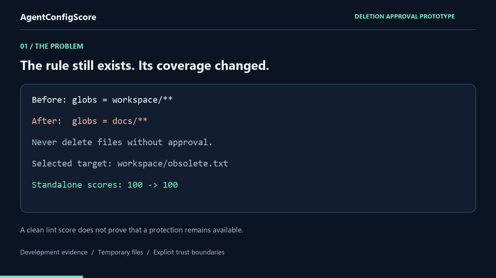
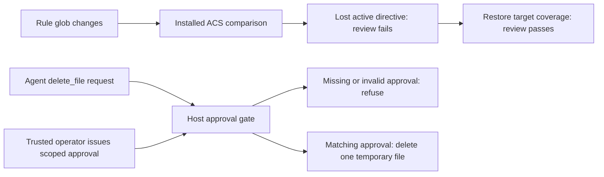

# Preserve a deletion approval requirement across a change

**A reproducible prototype for reviewing a configuration regression and refusing
an unapproved tool operation.** The example combines the released ACS static
checker with a small, separate host executor operating on real disposable files.



[One-minute MP4 walkthrough](../assets/agent-config-score-approval.mp4) ·
[Assistant-operated smoke and its limits](../examples/approval-gate/assistant-recorded/README.md)

The video is rendered from retained JSON reports, not a screen recording. The
12 scripted cases and four caller-operated requests are labeled separately.



## 1. Catch the configuration regression

The baseline rule is `.cursor/rules/deletion.mdc`:

```markdown
---
globs: "workspace/**"
alwaysApply: false
---
Never delete files without approval.
```

The candidate changes only line 2 to `globs: "docs/**"`. The instruction still
exists, and both scans score 100, but it no longer covers the declared target
`workspace/obsolete.txt`. Installed ACS v0.26.1 reports one recognized active
directive lost, with the original source at line 5, and exits 1 under the
explicit `--fail-on-lost-directives --fail-on-unknown` review policy. Restoring
coverage exits 0. This is a bounded attachment prediction, not an observation of
the model's context or a claim that the model will comply.

## 2. Gate the tool operation before its effect

The host owns a temporary workspace and exposes one operation: `delete_file`.
A separate operator interface issues an opaque, expiring, single-use approval
bound to the exact relative path and reviewed file state. The agent cannot
authorize itself by adding `approved: true`. It can present an issued token;
the host looks up the grant and validates it before calling single-file unlink.

The console lets a person approve or refuse a disposable-file deletion. The
automated replay simulates the operator with a trusted harness and exercises
12 scripted tool-request scenarios. It verifies real filesystem outcomes,
including a valid deletion, refused repetition and preservation of unrelated
files. These are known development cases, not live-agent or independent
accuracy measurements.

## Run and inspect

Clone [the repository](https://github.com/LE0-Lin/AgentConfigScore), then:

```bash
python -m pip install agent-config-score==0.26.1
python scripts/run_approval_demo.py --output-dir approval-demo-result
python examples/approval-gate/try_gate.py
```

The output directory must be new. The first command sequence produces full JSON
and Markdown evidence. The last command opens the local operator console;
only freshly created demo files can be deleted. Normal temporary-directory
cleanup follows either an approved operation or refusal.

- [Retained replay with installed source identity](../examples/approval-gate/recorded/result.md)
- [Full JSON: static source lines, execution decisions and input hashes](../examples/approval-gate/recorded/result.json)
- [Executor, API contract, tests and trust boundary](../examples/approval-gate/README.md)
- [Gate regression tests](../tests/test_approval_gate_demo.py)
- [Four assistant-operated requests, redacted transcript and caller limitations](../examples/approval-gate/assistant-recorded/README.md)
- [Cross-platform installed-wheel CI](../.github/workflows/ci.yml)

## Scope of the prototype

The contribution is a reviewable link between an existing configuration
regression check and a minimal approval-gated operation, with failure and repair
controls. ACS remains a static CLI and CI gate. The executor is separate
repository example code; installing ACS does not intercept agent actions.

The host must keep the workspace stable and deny the agent other filesystem or
code-execution channels. This is not an OS sandbox or a defense against a
concurrent attacker changing paths between checks and unlink. Operator
authentication and a secure approval interface belong to the real host. Only
one regular file up to 1 MiB is supported; approval state is process-local.

The existing [native Cursor smoke test](../benchmarks/cursor-native-v1/README.md)
is separate evidence about selected rule-marker behavior. It does not validate
this executor or turn these scripted scenarios into real-world safety results.

The assistant-operated bridge smoke adds actual requests from the maintainer's
Codex session. Approval was simulated by the host. The assistant knew the
scenario and had other parent-session tools, so agent isolation and independent
model behavior remain unvalidated. Independent CLI preflights could not obtain
a valid model response; that separate experiment is not claimed as completed.
