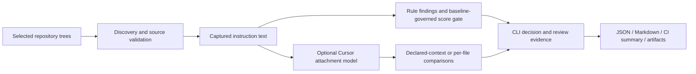

# Architecture and scope

AgentConfigScore is a dependency-free Python CLI and GitHub Action for local
instruction linting and deterministic PR regression checks.

## Core design decisions

- **Baseline ownership:** `diff` and `compare` apply the baseline repository's
  policy and suppressions to both trees. A candidate PR cannot lower its own
  threshold or suppress its own new errors. Explicit CLI/Action overrides remain
  caller-owned.
- **Captured source:** instruction text read during a scan is reused for
  regression checks (`instruction-file-removed`, `directive-polarity-flip`), and
  Cursor rules are parsed once per tree rather than reopened per target file.
- **Two Cursor context views:** `scope compare`/`diff` evaluates a declared
  multi-file task context; `scope coverage` evaluates each inventoried regular
  file independently so an API-only rule loss is not masked by a matching
  frontend file.
- **Explicit uncertainty:** manual/model-selected rules, unsupported metadata,
  and uninterpreted rule bodies stay `unknown` rather than being treated as
  clean.
- **Reproducible decisions:** stable rule IDs, source-line locations, typed exit
  codes (`0` pass, `1` gate failed, `2` operational failure), and tool source
  fingerprints make CI decisions auditable.

## Shipped surfaces and verification

| Surface | Shipped behavior | Verification |
|---|---|---|
| Packaging | Wheel, sdist, `agent-config-score`, `acs`, and `python -m agent_config_score` | Installed-package acceptance on Linux, Windows, and macOS |
| Setup | `init` with dry-run, conflict refusal, idempotence, `--force`, and `--workflow-only` | Disposable repo tests and input-byte preservation checks |
| Review | Scored regressions plus opt-in unscored Cursor coverage with source lines | Positive, repair, rename, unchanged, and unknown controls |
| CI | Read-only Action gate, optional PR comment recipe, summaries, and artifacts | Composite Action tests on disposable Git fixtures |
| Failure handling | Operational errors exit `2` without emitting a success report | Invalid/unreadable inputs and report-write failure tests |

## Out of scope

Runtime agent enforcement, native Cursor attachment observation, arbitrary-prose
semantics, and independent real-world accuracy benchmarks are outside the
shipped static CLI contract. See the separate
[native Cursor smoke report](../benchmarks/cursor-native-v1/README.md) and
[limitations](limitations.md) for details.
