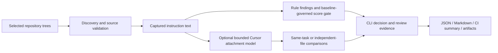

# Design and shipped product boundary

AgentConfigScore ships a dependency-free Python CLI and GitHub Action for local
instruction lint and deterministic change review. A complete supported journey
is installation, safe setup, a baseline comparison, source-located findings,
reviewed correction or audited exception, rerun and retained CI evidence.

## Decisions that matter

- **Baseline ownership.** Normal score comparisons apply the reviewed baseline
  policy and suppression set to both trees. A candidate cannot use its own
  weaker threshold or new exception to authorize that same change. Explicit
  CLI/Action overrides and workflow/tool revisions remain caller trust boundaries.
- **Captured source.** Instruction text that produced a scan is reused for its
  regression checks. Cursor sources are captured once per side and evaluated
  repeatedly without reopening each rule for each target. Filesystem checks
  reduce accidental boundary violations while requiring stable trees.
- **Two context questions.** A declared multi-file task can retain a rule through
  any matching file. Per-file coverage independently evaluates each selected
  existing name and can reveal an API-only loss. This does not infer a user's
  real task or establish native attachment.
- **Explicit uncertainty.** Manual/model loading, unsupported metadata and
  opaque potentially active bodies stay unknown. Unknowns have a separate review
  flag. An empty recognized baseline protects zero identities and stays visible.
- **Reproducible decisions.** Stable rule IDs, input/source identities, original
  line evidence and typed exit behavior make specified decisions reviewable.
  Scores describe active rule matches. Tool fingerprints identify covered
  source bytes and do not authenticate a whole execution environment.

## Product acceptance

| Surface | Shipped behavior | Acceptance evidence |
| --- | --- | --- |
| Installation | Wheel, source distribution, two aliases and module entrypoint | Isolated installed acceptance on three operating systems |
| Setup | Dry run, conflict refusal, idempotence, explicit overwrite and workflow-only scope | Disposable repositories and input-byte preservation checks |
| Review | Scored regressions plus opt-in unscored coverage, with source locations | Positive, repair, rename, unchanged and unknown controls |
| CI | Ordinary gate plus optional strict coverage, summaries and retained reports | Actual composite Action on disposable Git fixtures |
| Failure handling | Operational failures use exit `2`, without successful coverage evidence | Empty/invalid/unreadable inputs and report-write failures |
| Recovery | Documented policy migration, history recovery and audited exceptions | Core guides, installed checks and explicit compatibility notes |

Native Cursor attachment fidelity, arbitrary-prose semantics, agent execution
enforcement and independent real-world accuracy are outside the shipped static
contract. They remain separate validation or product directions. Maintained
acceptance cases demonstrate engineering behavior and do not establish adoption.

A [separate native Cursor smoke report](../benchmarks/cursor-native-v1/README.md)
now retains versioned behavioral observations with screenshot and hook evidence.
It does not expand the static product's guarantees or establish complete loading.
