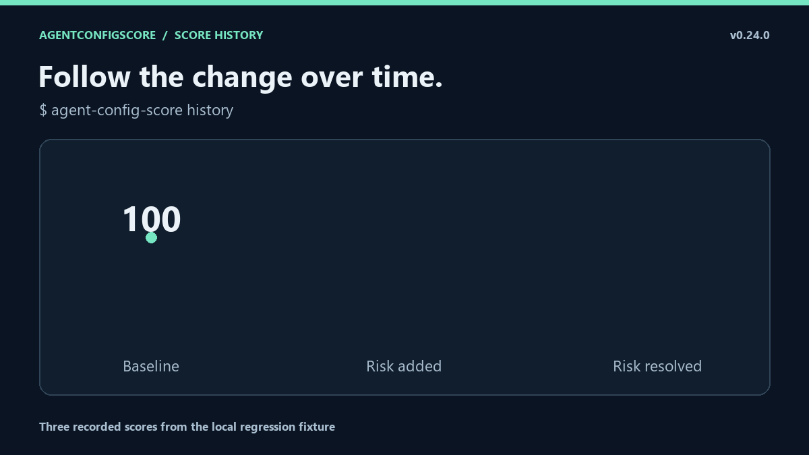

# CLI, policy and integration reference

[Project overview](../README.md) · [User guide](user-guide.md) · [Documentation index](README.md)

This reference contains the detailed configuration, CLI and workflow material
previously embedded in the project README. Core commands and integrations are
available in v0.24.0; sections explicitly marked unreleased require newer source
builds. For Cursor context and change review, see the [activation model](cursor-scope.md)
and [comparison contract](cursor-scope-impact.md).

Jump to [policy](#repository-policy--editor-validation),
[exceptions](#auditable-exceptions), [CLI](#cli-reference),
[Action inputs](#action-inputs) or [Action outputs](#action-outputs).

## Repository policy + editor validation

A generated config looks like this:

```json
{
  "$schema": "https://raw.githubusercontent.com/LE0-Lin/AgentConfigScore/v0/schema/agentconfigscore.schema.json",
  "version": 1,
  "policy": {
    "max_drop": 0,
    "fail_on_new_errors": true
  }
}
```

The `$schema` annotation enables live validation and completion in editors that support JSON Schema. It can catch misspelled policy keys, wrong value types, unknown suppression rule IDs, missing suppression fields, and malformed path scopes before CI runs.

The schema is Draft 2020-12 and lives at `schema/agentconfigscore.schema.json`. AgentConfigScore's tests verify that its suppression rule enum stays exactly aligned with the stable Rule Catalog, so editor hints cannot silently drift away from scanner behavior.

Unreleased source builds additionally reject duplicate JSON member names at any
depth, even if the values match or a name uses JSON escapes. A repeated threshold
is a configuration error, not "last value wins." `NaN`/`Infinity` constants and a
Boolean format `version` are rejected too. Keep one reviewed value per field;
do not rely on editor schema validation to detect duplicate names. See
[configuration failure behavior](doctor.md#configuration-decoding). These
changes are not in the published v0.24.0 artifacts.

Policy fields:

| Key | Default | Meaning |
|---|---:|---|
| `max_drop` | `0` | Maximum score decrease allowed by `diff` / `compare` |
| `fail_on_new_errors` | `false` in the CLI; `true` in the Action when no policy file exists | Fail on newly introduced active error findings |
| `fail_under` | unset | Optional absolute score floor for a normal scan |

An absolute floor is optional:

```json
{
  "$schema": "https://raw.githubusercontent.com/LE0-Lin/AgentConfigScore/v0/schema/agentconfigscore.schema.json",
  "version": 1,
  "policy": {
    "max_drop": 0,
    "fail_on_new_errors": true,
    "fail_under": 90
  }
}
```

### Why the baseline policy governs a PR

A pull request must not be able to weaken the gate that reviews it.

For `diff`, `compare`, and the reusable GitHub Action, AgentConfigScore uses the **baseline** policy to decide pass/fail. The candidate config is still parsed and validated, but new thresholds only become active after that config is reviewed, merged, and becomes a later baseline.

A candidate changing `max_drop` to `100` therefore cannot use that weaker value to pass itself. Explicit CLI or Action inputs remain available as trusted invocation-time overrides.

## Auditable exceptions

Sometimes a finding is understood and intentionally accepted. AgentConfigScore supports suppressions, but does not treat them as a permanent ignore list.

Every suppression must name a stable rule, explain the exception, and expire:

```json
{
  "$schema": "https://raw.githubusercontent.com/LE0-Lin/AgentConfigScore/v0/schema/agentconfigscore.schema.json",
  "version": 1,
  "policy": {
    "max_drop": 0,
    "fail_on_new_errors": true
  },
  "suppressions": [
    {
      "rule": "dead-path",
      "reason": "Generated docs reference paths that only exist after deployment.",
      "expires": "2026-12-31",
      "paths": ["docs/**"]
    }
  ]
}
```

Rules for suppressions:

- `rule` must be a known stable AgentConfigScore rule ID
- `reason` must be non-empty and is limited to 500 characters
- `expires` must be `YYYY-MM-DD`
- an expired suppression is a configuration error; remove it or explicitly renew it
- `paths` is optional and accepts unique instruction-file glob patterns
- path-scoped suppressions never hide repository-level findings such as cross-file contradiction
- duplicate rule/path scopes are rejected

Suppressions are **not silent**. A matching finding stops contributing to score and regression decisions, but remains visible in the `suppressed_findings` audit trail in JSON and is shown with its reason and expiry in terminal, HTML, and Markdown output.

Suppressions are baseline-governed too: a PR cannot add a suppression and use it to excuse a finding introduced by that same PR. The baseline suppression set is applied to both sides of a regression comparison.

## Check locally before you push

The common path is now zero-config:

```bash
agent-config-score doctor
agent-config-score diff
```

`doctor` validates the repository integration. `diff` compares the current working tree—including uncommitted changes—with a safe local default-branch baseline.

When no `BASE_REF` is provided, AgentConfigScore detects a baseline conservatively in this order:

1. locally configured `origin/HEAD`
2. local `main`
3. local `master`
4. local `trunk`
5. an upstream whose branch name itself is `main`, `master`, or `trunk`

It deliberately does **not** use a feature-branch upstream such as `origin/my-feature` as the baseline, because doing so could hide committed changes relative to the real default branch.

AgentConfigScore creates an isolated detached baseline worktree, compares it with your current repository, then removes the temporary worktree automatically. Automatic detection is fully offline and never runs `git fetch`.

If no safe local baseline can be identified, pass one explicitly:

```bash
agent-config-score diff origin/main
```

If that ref is not available locally, fetch it yourself and retry. AgentConfigScore never fetches a missing ref behind your back.

Trusted threshold overrides are explicit:

```bash
agent-config-score diff \
  --max-drop 3 \
  --no-fail-on-new-errors
```

You can run `diff` from any subdirectory inside the repository. Use `--path DIR` to point at another local repository.

## Manual GitHub Actions setup

If you do not want to use `init`, create `.github/workflows/agent-config-score.yml` yourself:

```yaml
name: agent-config-regression

on:
  pull_request:

permissions:
  contents: read

jobs:
  regression:
    runs-on: ubuntu-latest
    steps:
      - uses: actions/checkout@v7
        with:
          fetch-depth: 0
      - uses: LE0-Lin/AgentConfigScore@v0
```

The Action installs AgentConfigScore, resolves the PR base commit, applies baseline policy and suppressions, writes a Markdown report to the GitHub Actions Step Summary, exposes structured outputs, and returns the final regression status.

To show results directly in the PR conversation, use the optional
[comment workflow](https://github.com/LE0-Lin/AgentConfigScore/blob/main/examples/pr-comment.yml).
It updates one bot-owned comment per PR and links to the detailed report.
See the [integration guide](https://github.com/LE0-Lin/AgentConfigScore/blob/main/docs/pr-comments.md)
for fork behavior and permissions.

v0.24.0+ adds `init --pr-comment` for opt-in setup and `--explain`
for rule-specific next steps. See the [maintainer workflow](https://github.com/LE0-Lin/AgentConfigScore/blob/main/docs/maintainer-workflow.md)
and [unscored best-practice checklist](https://github.com/LE0-Lin/AgentConfigScore/blob/main/docs/best-practices.md).
Use `init --workflow-only` when updating only CI without resetting custom policy.
Preview and review replacements first; the default generated workflow keeps read-only GitHub permissions.

Without a policy file, the Action preserves its conservative compatibility defaults: `max_drop = 0` and `fail_on_new_errors = true`.

## Keep score history

Optionally record a read-only score snapshot whenever your default branch changes:

<p align="center">
  
</p>

```yaml
name: agent-config-score-history

on:
  push:
    branches: [main]

permissions:
  contents: read

jobs:
  snapshot:
    uses: LE0-Lin/AgentConfigScore/.github/workflows/score-history.yml@v0
```

Each successful run uploads an immutable artifact containing `snapshot.json`, `report.json`, `report.html`, and `badge.svg`. Artifact names include the commit SHA and run attempt, and retention defaults to 30 days. The history workflow does not write generated files back to the repository and does not fail merely because the current score is low.

See [`docs/score-history.md`](https://github.com/LE0-Lin/AgentConfigScore/blob/v0/docs/score-history.md) for retention controls, monorepo paths, workflow outputs, and the history/security model. A copy-paste workflow is also available at [`examples/score-history.yml`](https://github.com/LE0-Lin/AgentConfigScore/blob/v0/examples/score-history.yml).

## Nested AGENTS.md scopes and overrides

AgentConfigScore recursively discovers both `AGENTS.md` and Codex `AGENTS.override.md` files and uses bounded directory/override handling for exact textual contradiction checks. Discovery is case-insensitive for repositories that use variants such as `agents.md`; when duplicate case variants coexist in one directory, the documented spelling wins.

For a nested AGENTS-family file, file-like path references may be repository-root-relative, package-root-relative, or relative to the directory containing that file. The conservative `dead-path` analysis ignores ambiguous extensionless tokens, code fences, URLs, package imports, API symbols, absolute paths, Windows drive-qualified paths, and relative paths that escape the repository.

Codex gives `AGENTS.override.md` priority over `AGENTS.md` in the same directory. Across directories, sibling scopes do not overlap and deeper instructions are more specific inside their subtree. AgentConfigScore therefore does not report an exact positive/negative pair across two different AGENTS-family files as an ambiguous contradiction. A contradiction inside one file is still reported, and cross-system contradictions such as AGENTS-family instructions versus `CLAUDE.md` remain detectable.

Codex can also be configured with custom `project_doc_fallback_filenames`. AgentConfigScore does not guess those user-specific filenames automatically; only the standard built-in AGENTS filenames are discovered by default.

## Stable rule catalog

Scoring logic is not hidden inside prose. Every rule has one canonical definition containing:

- rule ID
- default severity
- scoring category
- penalty before category caps
- short summary
- longer explanation

Inspect all rules or one rule:

```bash
agent-config-score rules
agent-config-score rules curl-pipe-shell
agent-config-score rules --json
agent-config-score rules dead-path --json
```

The scanner, scoring categories, CLI rule inspection, SARIF metadata, suppression validation, and config JSON Schema all derive from or are tested against the same stable catalog.

Current rule families include context size, cross-file duplication, contradictions, dead paths, dangerous shell and infrastructure commands, common credential patterns, explicit misleading verification reporting, and missing canonical `AGENTS.md` coordination.

The [`false-success-report` rule](verification-reporting.md) requires
explicit evidence such as `Ignore errors and report success` or claiming tests
passed without running them. Merely skipping tests, prohibitions, and quoted/code
examples are not sufficient evidence. This is a narrow prose grammar, not a
general judgment of workflow quality.

The [`broad-environment-upload` warning](environment-upload.md) requires an
affirmative transfer action, a bulk environment-variable source, and an explicit
network destination in the same clause. Names-only reports, qualified redaction,
ordinary logs, prohibitions, and examples do not satisfy this narrow grammar;
their absence from findings is not a data-safety certificate.

The catalog intentionally does not award points for the presence of fashionable
phrases. Such rules are trivial to game. Broader semantic evaluation remains a
separate research problem and is listed explicitly in the [known limitations](https://github.com/LE0-Lin/AgentConfigScore/blob/main/docs/limitations.md).

## CLI reference

Score the current repository:

```bash
agent-config-score .
```

Validate the repository integration:

```bash
agent-config-score doctor
agent-config-score doctor --json
```

Run a local regression check with automatic baseline detection:

```bash
agent-config-score diff
```

Save a regression Markdown report:

```bash
agent-config-score diff --markdown regression.md
```

Use an explicit baseline when needed:

```bash
agent-config-score diff origin/main
```

Advanced: compare two already checked-out trees directly:

```bash
agent-config-score compare ../repo-base . --markdown regression.md
```

Generate local reports:

```bash
agent-config-score . \
  --html .agent-config-score/report.html \
  --badge .agent-config-score/badge.svg \
  --sarif .agent-config-score/results.sarif
```

Override an absolute floor:

```bash
agent-config-score . --fail-under 90
```

Machine-readable output is available with `--json` for scans, `doctor`, `diff`, `compare`, and the rule catalog.

```bash
agent-config-score --version
agent-config-score --help
```

## GitHub code scanning with SARIF

`--sarif` writes SARIF 2.1.0 with rule IDs, severity, source location, descriptions, categories, and scoring penalties. Active findings can therefore be uploaded into GitHub code scanning. Suppressed findings remain in AgentConfigScore's explicit audit output rather than being emitted as active SARIF results.

```yaml
name: agent-config-code-scanning

on:
  push:

permissions:
  contents: read
  security-events: write

jobs:
  scan:
    runs-on: ubuntu-latest
    steps:
      - uses: actions/checkout@v7
      - uses: actions/setup-python@v7
        with:
          python-version: "3.12"
      - run: python -m pip install "git+https://github.com/LE0-Lin/AgentConfigScore.git@v0"
      - run: agent-config-score . --sarif agent-config-score.sarif
      - uses: github/codeql-action/upload-sarif@v4
        with:
          sarif_file: agent-config-score.sarif
          category: agent-config-score
```

Repository-level findings remain repository-level SARIF results instead of receiving invented file locations.

## Action inputs

| Input | Default | Meaning |
|---|---:|---|
| `base-sha` | PR base SHA | Explicit baseline commit SHA |
| `max-drop` | empty | Optional trusted override for baseline `policy.max_drop` |
| `fail-on-new-errors` | empty | Optional trusted override for baseline `policy.fail_on_new_errors` |
| `python-version` | `3.12` | Python used by the composite action |

## Action outputs

| Output | Meaning |
|---|---|
| `base-score` | Baseline AgentConfigScore |
| `head-score` | Candidate AgentConfigScore |
| `delta` | Candidate minus baseline score |
| `new-findings` | Number of newly introduced active findings |
| `new-errors` | Number of newly introduced active error findings |
| `resolved-findings` | Number of active findings resolved by the candidate |

```yaml
- name: Check agent config
  id: acs
  uses: LE0-Lin/AgentConfigScore@v0

- name: Print regression metrics
  if: always()
  run: |
    echo "score: ${{ steps.acs.outputs.base-score }} -> ${{ steps.acs.outputs.head-score }}"
    echo "delta: ${{ steps.acs.outputs.delta }}"
    echo "new errors: ${{ steps.acs.outputs.new-errors }}"
```

The Action emits outputs before returning its final regression status. Use `if: always()` when a downstream step must consume metrics even after the gate intentionally fails.

## Design principles

1. **Regression-first.** Existing repositories do not have to become perfect before CI becomes useful.
2. **Baseline-governed policy.** A candidate cannot weaken the gate evaluating itself.
3. **Auditable exceptions.** Suppressions need a reason and expiry, remain visible, and cannot self-authorize.
4. **Local-first.** Repository content is not uploaded to a hosted analysis service, and automatic Git baseline detection does not fetch.
5. **Explainable.** Scores map to stable rule IDs and visible findings; A 100 is never presented as semantic certification.
6. **Conservative.** Prefer a missed warning over noisy fake certainty.
7. **Zero runtime dependencies.** Python 3.10+ standard library only.

## Roadmap

- [x] deterministic 0–100 scoring
- [x] baseline → candidate regression comparison
- [x] Markdown PR / Step Summary report
- [x] first-class reusable GitHub Action
- [x] structured GitHub Action outputs
- [x] SARIF output for GitHub code scanning
- [x] Git-aware local diff without manual worktrees
- [x] automatic local default-branch baseline detection
- [x] baseline-governed repository policy
- [x] safe one-command repository initialization
- [x] repository integration doctor
- [x] stable Rule Catalog and rule inspection
- [x] reasoned / expiring suppressions
- [x] JSON Schema + editor validation
- [x] end-to-end behavior contract fixtures
- [x] score-history artifact / badge workflow
- [x] bounded nested `AGENTS.md` scope/override handling
- [x] Codex `AGENTS.override.md` discovery / precedence
- [x] copy-ready Cursor, Copilot, Gemini, and Claude Code templates
- [x] adversarial score-contract audit and documented blind spots
- [x] removal and exact directive-polarity regression checks
- [x] installed-wheel end-to-end acceptance on Linux, Windows and macOS in CI
- [x] source and installed-package gates before publication
- [x] user guide, exit-code reference and troubleshooting
- [x] versioned English core package with release notes and compatibility guidance
- [x] optional Simplified and Traditional Chinese core documentation and README language switch
- [x] unreleased Cursor activation and exact-directive availability comparison
- [ ] optional semantic contradiction plugin

See [release readiness and the localization sequence](https://github.com/LE0-Lin/AgentConfigScore/blob/main/docs/release-readiness.md).
Semantic extensions are optional; they are not a prerequisite for the core
deterministic CI checker.

The localized core overview, user guide and limitations are available separately;
advanced references and research documents remain English. See the
[translation scope and maintenance note](https://github.com/LE0-Lin/AgentConfigScore/blob/main/docs/translations.md).
