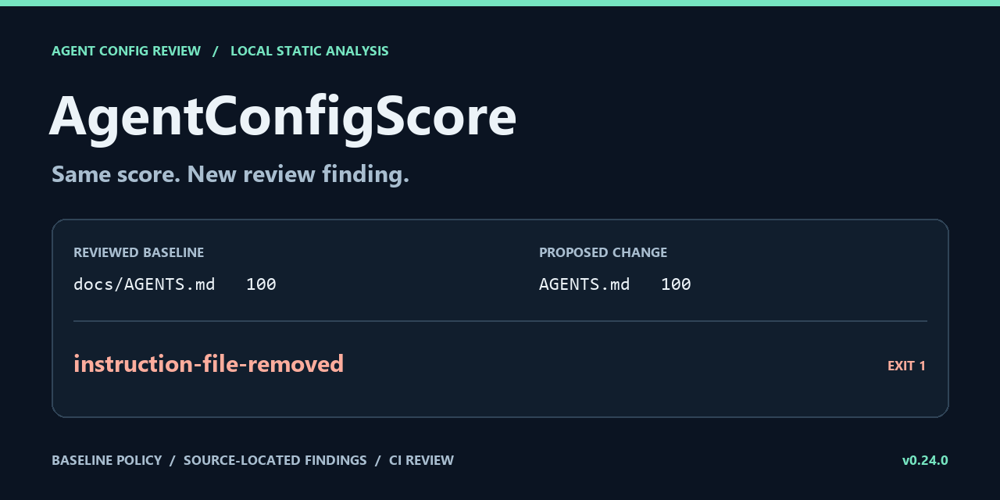
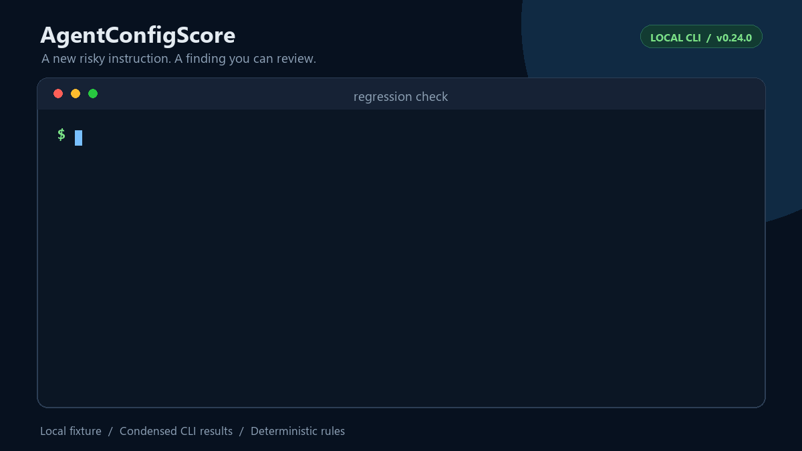
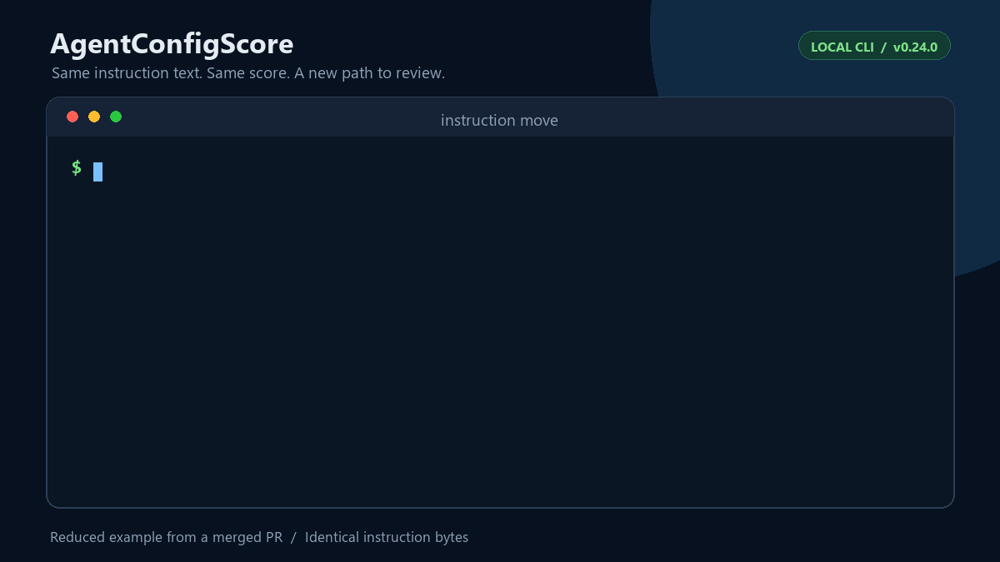
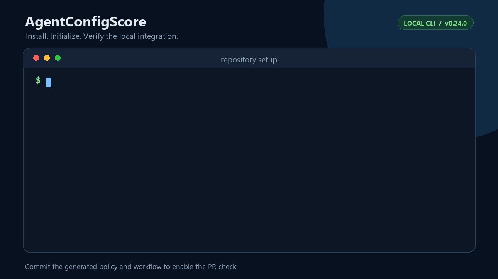
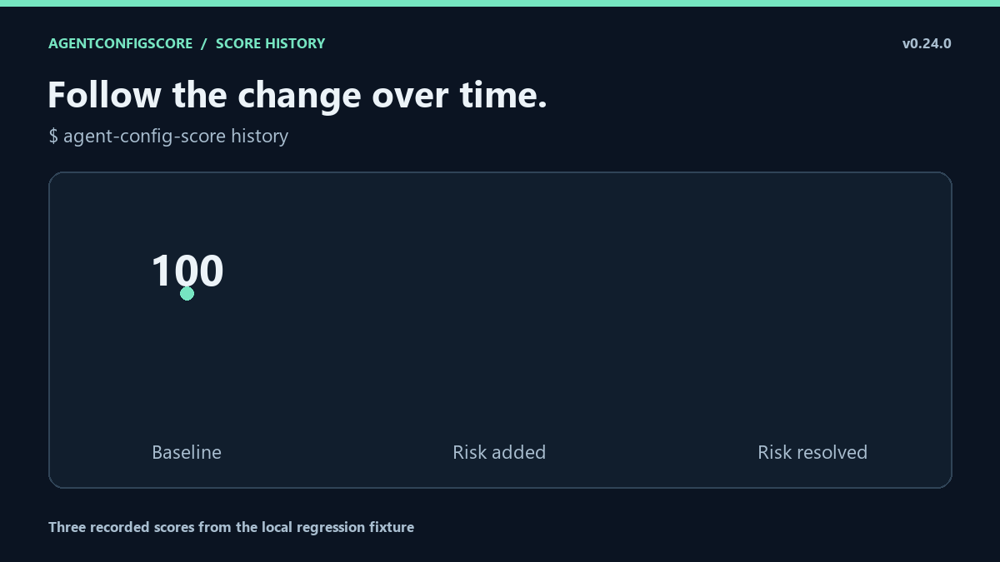
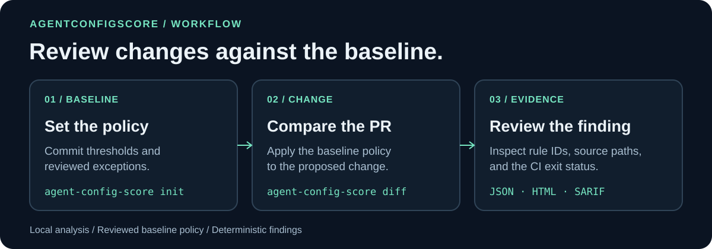

# Visual tour

The gallery visualizes findings, setup checks, and recorded scores from v0.24.0 on local fixtures. The terminal animations use condensed CLI results, with typing and timing added for presentation. [Read the score contract](limitations.md).

## Shareable project card



The solid-background 1280×640 project card is optimized for GitHub link previews and remains readable when a social platform crops or scales it down.

## Catch a regression before merge



Adding a remote-shell instruction produces `curl-pipe-shell` at `AGENTS.md:5`. The scores, grade, finding, and exit are read from the installed release. From a checkout, reproduce the comparison with the following commands. Exit 1 is expected.

```bash
cd tests/fixtures/contracts/regression/unsafe-shell
agent-config-score compare base head --fail-on-new-errors --max-drop 0
```

The fixture contains the remote-shell command as instruction text. The renderer scans that text without executing it.

## Review a scope move with an unchanged score



This additional `compare` run checks a byte-identical instruction moved across directories. The baseline policy gates the new finding, so the run returns exit 1 even though the scores match. [Reproduce the anonymized PR fixture](../examples/instruction-move/README.md).

## Set up a repository



The normal setup path is intentionally small: install from PyPI, run `init`, then use the read-only `doctor` command to verify configuration, instructions, baseline detection, and the GitHub workflow.

## Make known-risk changes visible over time



The table and chart show three local fixture snapshots for baseline, risk added, and risk resolved. They use the stored scores and grades read back with `history --json`. The reusable score-history workflow can preserve JSON, HTML, and badge artifacts for default-branch commits.

## How the pieces fit



The regression gate answers whether a pull request introduced a detected regression. History shows how the deterministic score changed across reviewed commits. They are separate signals with a shared scanner and policy model.

## Regenerate the gallery

Run the renderer in a Python 3.12 environment with Git available. It reads the installed release's CLI results, including the regression exit and selected `doctor` checks from a disposable Git repository. Font selection depends on the rendering host.

```bash
python -m pip install agent-config-score==0.24.0 pillow==12.3.0
python scripts/render_demo_gif.py --all
```

Commit the renderer and generated assets together so visual changes remain reviewable.
